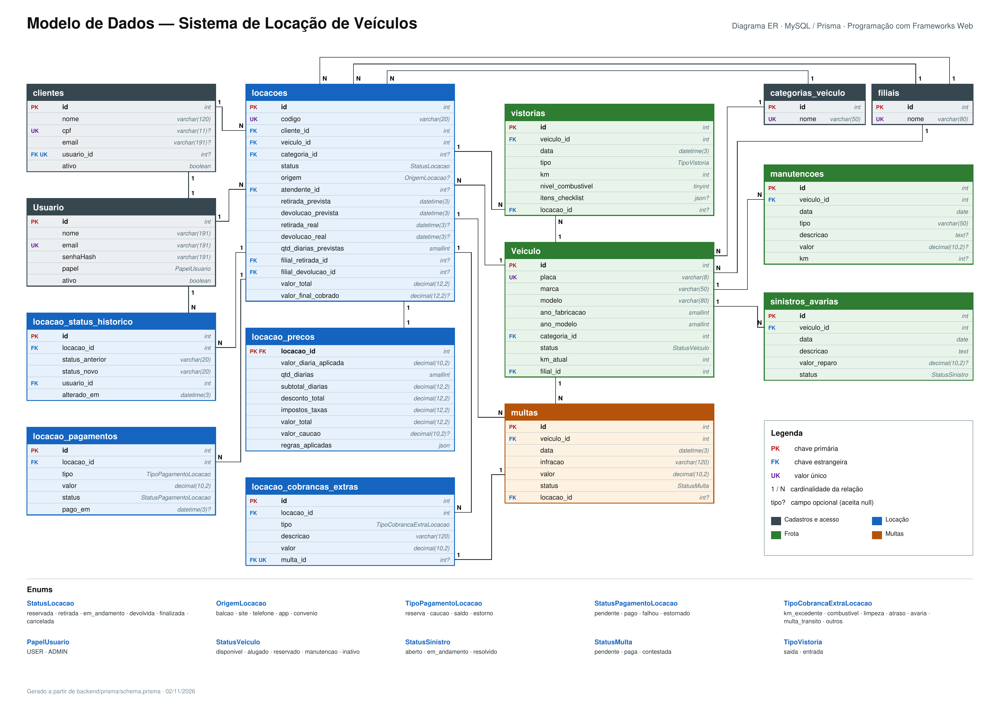

# Sistema de Locação de Veículos

Projeto full stack da atividade de Programação com Frameworks Web. A aplicação é dividida em uma API REST em Node.js/Express e uma interface React. A API é o núcleo das regras de negócio; o frontend a consome por `/api`, sem acessar o MySQL diretamente.

## Estrutura

```text
backend/   API REST, autenticação JWT, regras de negócio, Prisma e migrations
frontend/  Interface React/Vite e integração HTTP com a API
```

## Diagrama ER

O diagrama A4 apresenta um recorte operacional das principais entidades e relações do sistema. [Abrir ou baixar o PDF](modelo_er_locacao_A4.pdf).



## Fronteira de acesso

O navegador acessa o frontend e chama a API pela mesma origem usando `/api`. No desenvolvimento, o servidor Vite encaminha esse caminho ao backend local. No exemplo de produção em `deploy/nginx.conf`, o Nginx serve os arquivos públicos do frontend e encaminha `/api/*` ao backend em `127.0.0.1:3333`; não exponha as portas `3333` da API ou `3306` do MySQL. A implantação é um exemplo para host único e precisa ser adaptada ao provedor escolhido.

O backend continua sendo o núcleo do sistema. Integrações externas, quando adicionadas, devem ficar em `backend/src/integrations/`, ser usadas por serviços internos e nunca ser chamadas diretamente pelo navegador. O projeto ainda não tem integrações externas implementadas.

## Integração contínua

O workflow em `.github/workflows/ci.yml` roda em pull requests e pushes para `main`: valida o schema Prisma e gera o client, executa testes e auditoria npm no backend, roda um cenário da API contra MySQL 8 efêmero (aplicando as migrations) e executa auditoria npm e build de produção no frontend. O teste de integração não precisa ser habilitado nos testes locais sem MySQL.

Administradores podem listar, cadastrar e editar contas pela tela **Usuários**, alternar o perfil único `USER`/`ADMIN` e ativar ou inativar contas. A inativação preserva o histórico e bloqueia o acesso; redefinir a senha ou inativar revoga os tokens de sessão anteriores. O cadastro público continua criando somente `USER`.

Administradores também gerenciam o cadastro completo da frota (identificação, características, dados financeiros e documentação, status operacional, filial, categoria e opcionais), editam veículos e registram manutenções, sinistros/avarias, multas e vistorias. Detalhes financeiros e documentais são restritos a ADMIN; a lista comum retorna apenas campos de catálogo.
As tarifas são administradas separadamente em **Precificação**, por categoria e vigência; o cadastro do veículo não define uma diária. A API calcula a cotação para o período solicitado, aplica as regras configuradas e congela os valores na confirmação da locação.

## Requisitos

- Node.js 20 ou superior e npm
- Git
- MySQL
- Uma instância de MySQL acessível pelo backend

## Obter o projeto

```bash
git clone https://github.com/ARTHURNOBREGA1268/locadora-de-veiculos.git
cd locadora-de-veiculos
```

## Configuração local

1. Configure o banco MySQL e crie um banco para a aplicação.
2. No backend, copie `.env.example` para `.env` e preencha `DATABASE_URL`, `JWT_SECRET`, `JWT_EXPIRES_IN`, `HOST`, `PORT` e `CORS_ORIGIN`. Mantenha `HOST=127.0.0.1` para acesso local/proxy e gere `JWT_SECRET` com pelo menos 32 caracteres usando `openssl rand -base64 32`. Não compartilhe nem versione o arquivo `.env`.
3. No frontend, copie `frontend/.env.example` para `frontend/.env`. Mantenha `VITE_API_URL=/api`; `API_PROXY_TARGET` aponta o proxy de desenvolvimento para `http://127.0.0.1:3333` e não é publicado no bundle.

## Instalação e execução

Execute cada módulo em um terminal separado.

### Backend

```bash
cd backend
npm ci
npx prisma generate
npx prisma migrate deploy
npm run seed
npm run dev
```

### Conta administradora

O cadastro pela interface cria sempre uma conta comum (`USER`). Cadastre uma conta própria com senha forte e, na pasta `backend`, promova-a pelo terminal local:

```bash
npm run admin:promote -- admin@exemplo.com
```

Substitua o e-mail pelo da conta criada e confirme digitando `PROMOVER`. Depois, saia e entre novamente no sistema para atualizar a sessão. A tela de usuários e as ações administrativas são reservadas a `ADMIN`. Não promova a conta demo `demo@locadora.com` sem antes trocar a senha padrão `123456` por uma senha forte e única.

### Frontend

```bash
cd frontend
npm ci
npm run dev
```

Consulte também `backend/README.md`, `frontend/README.md` e `deploy/README.md` para detalhes de execução e do proxy. Os comandos de banco devem ser executados somente contra o banco local/de desenvolvimento configurado pelo integrante.

## Integrantes

- Arthur Nobreba Montengro — Backend
- Hgor Gabriel Alves Montenegro — Frontend
